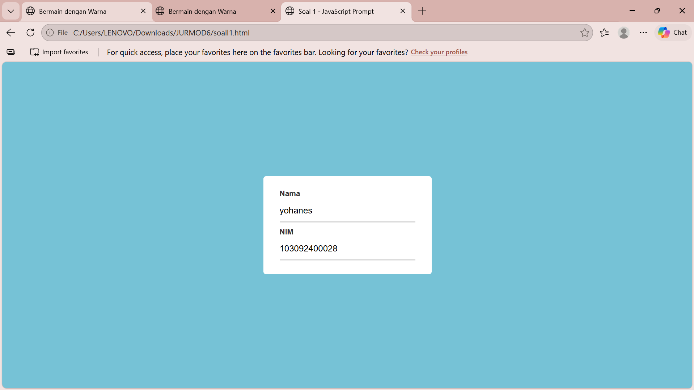
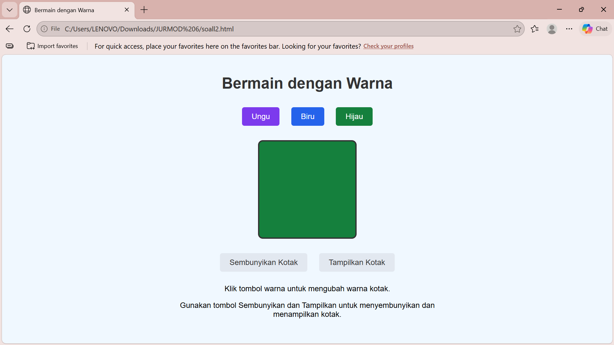

# \# Tugas Pendahuluan Modul 6 - Pemrograman Web

# \*\*Mata Kuliah:\*\* Pemrograman Web (Ganjil 2026/2027)  

# \*\*Fakultas Informatika, Telkom University\*\*

# 

# \---

# 

# \### \*\*1. Penjelasan JavaScript dan Kegunaannya\*\*

# \* \*\*JavaScript\*\* adalah bahasa pemrograman tingkat tinggi, dinamis, dan berorientasi objek yang dieksekusi di sisi klien (\*client-side\*) oleh peramban web (\*browser\*).

# \* \*\*Kegunaan:\*\* 

# &#x20; \* Menjadikan halaman web lebih interaktif dan dinamis.

# &#x20; \* Menangani kejadian (\*event handling\*) seperti klik tombol dan interaksi pengguna.

# &#x20; \* Memanipulasi elemen HTML dan CSS melalui DOM (\*Document Object Model\*).

# &#x20; \* Melakukan validasi formulir dan komunikasi asinkron (AJAX).

# 

# \### \*\*2. Penjelasan jQuery dan Kegunaannya\*\*

# \* \*\*jQuery\*\* adalah pustaka (\*library\*) JavaScript yang cepat, ringan, dan kaya fitur (\*lightweight\*).

# \* \*\*Kegunaan:\*\*

# &#x20; \* Menyederhanakan sintaks JavaScript yang kompleks menjadi jauh lebih ringkas (\*"write less, do more"\*).

# &#x20; \* Mempermudah manipulasi DOM dan penanganan \*event\* lintas peramban (\*cross-browser\*).

# &#x20; \* Menyediakan dukungan animasi dan efek visual bawaan dengan mudah.

# 

# \### \*\*3. Perbedaan JavaScript dan jQuery\*\*

# \* \*\*Definisi:\*\* JavaScript adalah bahasa pemrograman dasar yang mandiri, sedangkan jQuery adalah pustaka (\*library\*) yang dibangun di atas bahasa JavaScript.

# \* \*\*Panjang Sintaks:\*\* JavaScript murni (\*vanilla\*) membutuhkan baris kode yang lebih panjang untuk tugas tertentu, sementara jQuery menyediakan fungsi yang jauh lebih singkat dan efisien.

# \* \*\*Kompatibilitas:\*\* JavaScript terkadang memerlukan penanganan khusus untuk perbedaan antar \*browser\*, sedangkan jQuery otomatis menanganinya.

# \* \*\*Performa:\*\* JavaScript murni berjalan langsung pada mesin \*browser\* tanpa memuat berkas tambahan, sedangkan jQuery memerlukan pemuatan berkas pustaka (\*library\*) terlebih dahulu.

# 

# \---

# 

# \### \*\*4. Soal 1 (`soal1.html`)\*\*

# Implementasi skrip JavaScript untuk memunculkan dialog `prompt()` saat halaman pertama kali dimuat guna meminta input \*\*Nama\*\* dan \*\*NIM\*\*, kemudian menampilkannya secara otomatis ke dalam elemen \*form\*.

# 

# \* \*\*Output Program Soal 1:\*\*  

# &#x20; 

# 

# \---

# 

# \### \*\*5. Soal 2 (`soal2.html`)\*\*

# Implementasi interaksi halaman web menggunakan \*\*jQuery\*\* yang mencakup \*DOM manipulation\*, \*event handling\*, serta \*effects/animation\* untuk mengubah warna kotak (Ungu, Biru, Hijau) serta menyembunyikan/menampilkan kotak.

# 

# \* \*\*Output Program Soal 2:\*\*  

# &#x20; 

